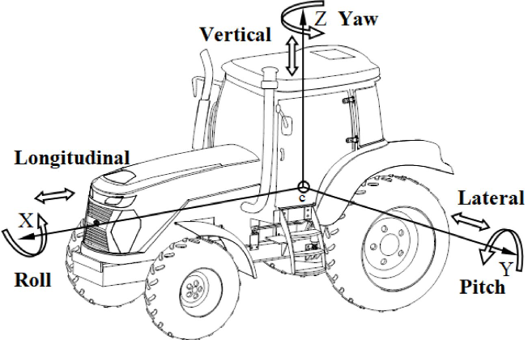
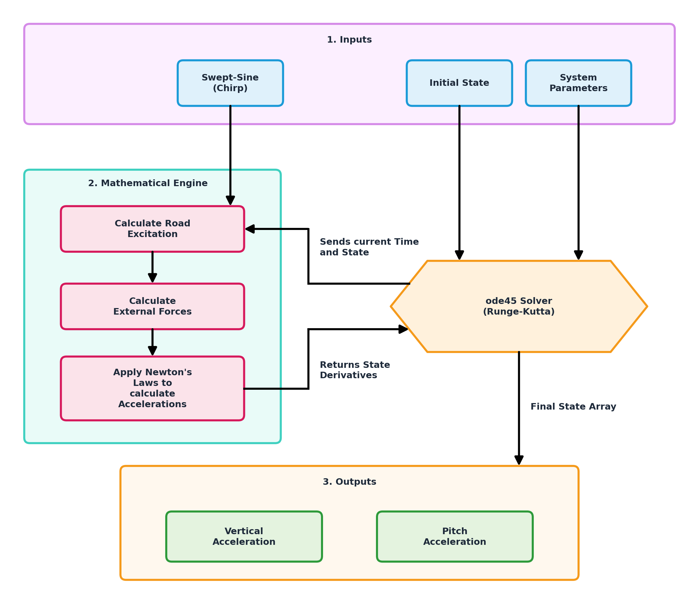
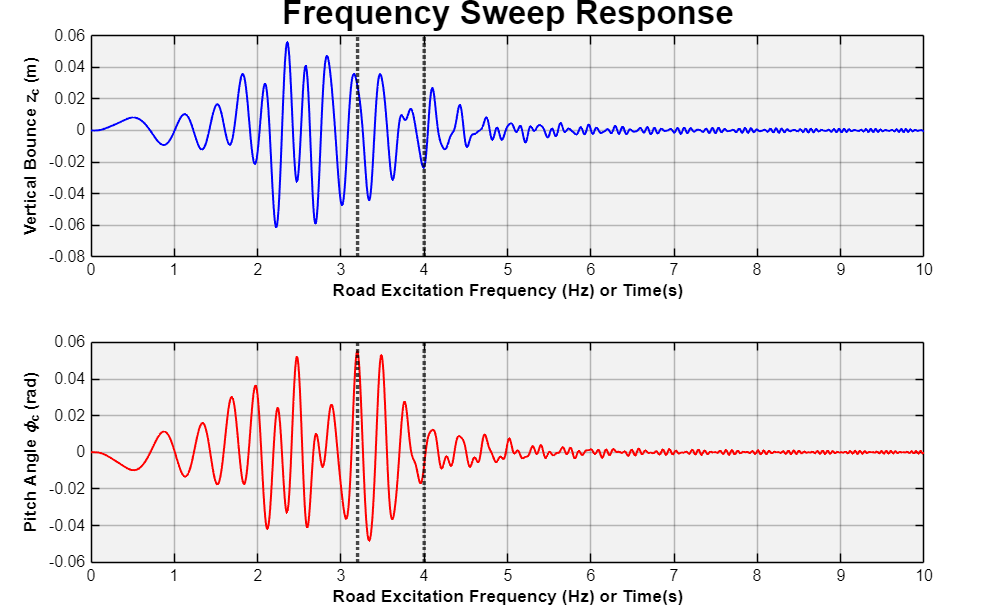
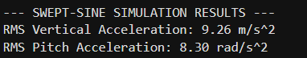
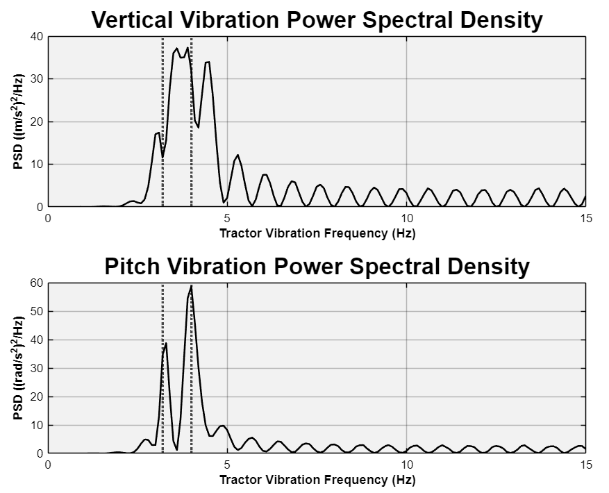
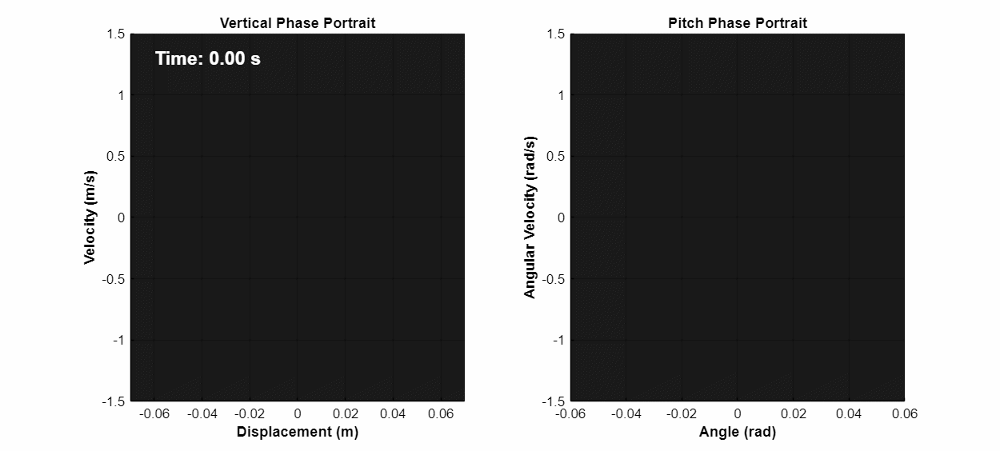
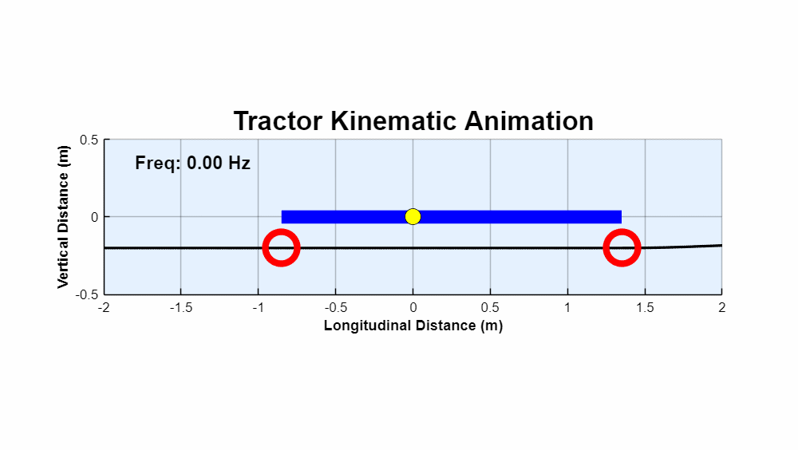

# Vibration Analysis of an Agricultural Tractor (2-DOF Model)

A numerical and analytical study of the vertical bounce and pitch vibration dynamics of an agricultural wheeled tractor subjected to road excitation. Developed as part of the course **ME3103: Dynamics of Machinery**, this repository contains the complete MATLAB simulation suite, frequency-domain Power Spectral Density (PSD) analysis, phase-plane stability portraits, kinematic animations, and the final project presentation.

---

## Table of Contents

1. [Repository Structure](#repository-structure)
2. [Mathematical Formulation](#mathematical-formulation)
   - [Governing Equations of Motion](#governing-equations-of-motion)
   - [System Parameters](#system-parameters)
   - [Free Vibration Analysis](#free-vibration-analysis)
3. [Simulation Architecture](#simulation-architecture)
4. [Results & Visualizations](#results--visualizations)
   - [Frequency Sweep (Chirp) Response](#frequency-sweep-chirp-response)
   - [Power Spectral Density (PSD) Analysis](#power-spectral-density-psd-analysis)
   - [Phase-Plane Stability Portraits](#phase-plane-stability-portraits)
   - [Real-Time Kinematic Animation](#real-time-kinematic-animation)
5. [How to Run](#how-to-run)
6. [References](#references)

---

## Repository Structure
```text
└── omniman2024-vibrating-tractor/
   ├── README.md                         # Project documentation
   ├── FINAL_PPT_ME3103_TEAM5.pptx       # Final project presentation slides
   ├── tractor_simulation_chirp.m        # Swept-sine (0–10 Hz) time-domain simulation & RMS metrics
   ├── tractor_psd_analysis.m            # FFT-based Power Spectral Density (PSD) analysis
   ├── tractor_phase_portraits.m         # Vertical & pitch phase-plane trajectory generator
   ├── tractor_simulation_kinematics.m   # 2-DOF tractor kinematic animation generator
   ├── tractor.png                       # Tractor reference / model illustration
   ├── tractor_flowchart.png             # Numerical integration & solver architecture flowchart
   ├── CHIRP_graphs.png                  # Vertical bounce & pitch response (0–10 Hz sweep)
   ├── SWEPTSINE_results.png             # Command window RMS acceleration outputs
   ├── PSD_graphs.png                    # Vertical & pitch Power Spectral Density plots
   ├── Tractor_Phases.gif                # Animated phase-plane stability trajectories
   └── Tractor_Kinematics.gif            # Animated 2-DOF tractor chassis motion
```
## Mathematical Formulation

Following the biaxial rigid suspension planar model, the agricultural tractor is modeled as a **2-Degree-of-Freedom (2-DOF)** dynamic system capturing vertical bounce ($z_c$) and pitch angle ($\phi_c$) about the chassis center of mass.

<p align="center">
  
</p>

### Governing Equations of Motion

Applying Newton's second law to the vertical and rotational degrees of freedom yields two coupled second-order ordinary differential equations:

$$m_c \ddot{z}_c + (c_f + c_r)\dot{z}_c + (k_f + k_r)z_c + (c_r l_r - c_f l_f)\dot{\phi}_c + (k_r l_r - k_f l_f)\phi_c = k_f h_f + c_f \dot{h}_f + k_r h_r + c_r \dot{h}_r$$

$$J_c \ddot{\phi}_c + (c_f l_f^2 + c_r l_r^2)\dot{\phi}_c + (k_f l_f^2 + k_r l_r^2)\phi_c + (c_r l_r - c_f l_f)\dot{z}_c + (k_r l_r - k_f l_f)z_c = c_r l_r \dot{h}_r - c_f l_f \dot{h}_f + k_r l_r h_r - k_f l_f h_f$$

In compact matrix form:

$$\mathbf{M}\ddot{\mathbf{q}} + \mathbf{C}\dot{\mathbf{q}} + \mathbf{K}\mathbf{q} = \mathbf{F}$$

where:

$$
\mathbf{q} = \begin{pmatrix} z_c \cr \phi_c \end{pmatrix}, \quad
\mathbf{M} = \begin{pmatrix} m_c & 0 \cr 0 & J_c \end{pmatrix}, \quad
\mathbf{C} = \begin{pmatrix} c_f + c_r & c_r l_r - c_f l_f \cr c_r l_r - c_f l_f & c_f l_f^2 + c_r l_r^2 \end{pmatrix}
$$

$$
\mathbf{K} = \begin{pmatrix} k_f + k_r & k_r l_r - k_f l_f \cr k_r l_r - k_f l_f & k_f l_f^2 + k_r l_r^2 \end{pmatrix}, \quad
\mathbf{F} = \begin{pmatrix} k_f h_f + c_f \dot{h}_f + k_r h_r + c_r \dot{h}_r \cr c_r l_r \dot{h}_r - c_f l_f \dot{h}_f + k_r l_r h_r - k_f l_f h_f \end{pmatrix}
$$

As the tractor moves forward at velocity $v$, the rear wheels experience the same road profile as the front wheels after a time delay $\tau$:

$$\tau = \frac{l_f + l_r}{v}, \qquad h_r(t) = \begin{cases} 0, & t < \tau \cr h_f(t - \tau), & t \ge \tau \end{cases}$$

---

### System Parameters

Baseline physical parameters adopted from the research paper:

| Parameter | Symbol | Value | Unit |
| :--- | :---: | :---: | :---: |
| Tractor chassis mass | $m_c$ | $2700$ | $\text{kg}$ |
| Pitch moment of inertia | $J_c$ | $3600$ | $\text{kg}\cdot\text{m}^2$ |
| Front tire stiffness | $k_f$ | $714,400$ | $\text{N/m}$ |
| Rear tire stiffness | $k_r$ | $718,600$ | $\text{N/m}$ |
| Front tire damping | $c_f$ | $3,600$ | $\text{N}\cdot\text{s/m}$ |
| Rear tire damping | $c_r$ | $5,100$ | $\text{N}\cdot\text{s/m}$ |
| Front axle to CoM distance | $l_f$ | $1.35$ | $\text{m}$ |
| Rear axle to CoM distance | $l_r$ | $0.85$ | $\text{m}$ |
| Tractor forward velocity | $v$ | $6.0$ | $\text{km/h}\$ |
| Road bump amplitude | $A$ | $0.02$ | $\text{m}$ |

---

### Free Vibration Analysis

Setting damping and external forcing to zero ($\mathbf{C} = \mathbf{0}$, $\mathbf{F} = \mathbf{0}$) gives the undamped free-vibration system:

$$\mathbf{M}\ddot{\mathbf{q}} + \mathbf{K}\mathbf{q} = \mathbf{0}$$

Substituting the harmonic solution $\mathbf{q}(t) = \mathbf{Q}\sin(\omega t)$ yields the characteristic eigenvalue equation:

$$\det(\mathbf{K} - \omega^2\mathbf{M}) = 0$$

Solving for the two coupled principal natural circular frequencies:

$$\omega_1^2 = \frac{1}{2}\left[\omega_{0z}^2 + \omega_{0\phi}^2 - \sqrt{(\omega_{0z}^2 - \omega_{0\phi}^2)^2 + 4\eta_1\eta_2}\right]$$

$$\omega_2^2 = \frac{1}{2}\left[\omega_{0z}^2 + \omega_{0\phi}^2 + \sqrt{(\omega_{0z}^2 - \omega_{0\phi}^2)^2 + 4\eta_1\eta_2}\right]$$

where:

$$\omega_{0z} = \sqrt{\frac{k_f + k_r}{m_c}}, \quad
\omega_{0\phi} = \sqrt{\frac{k_f l_f^2 + k_r l_r^2}{J_c}}, \quad
\eta_1 = \frac{k_f l_f - k_r l_r}{m_c}, \quad
\eta_2 = \frac{k_f l_f - k_r l_r}{J_c}$$

Substituting the baseline parameters yields the two coupled natural frequencies:
* **First Natural Frequency ($f_1 = \omega_1 / 2\pi$):** $\approx \mathbf{3.2\text{ Hz}}$
* **Second Natural Frequency ($f_2 = \omega_2 / 2\pi$):** $\approx \mathbf{4.0\text{ Hz}}$

---

## Simulation Architecture

To numerically solve the coupled second-order equations of motion, the 2-DOF system is reformulated into a 4-state first-order state-space system:

$$
\mathbf{x} = \begin{bmatrix} z_c \cr \dot{z}_c \cr \phi_c \cr \dot{\phi}_c \end{bmatrix}, \qquad \dot{\mathbf{x}} = \begin{bmatrix} \dot{z}_c \cr \ddot{z}_c \cr \dot{\phi}_c \cr \ddot{\phi}_c \end{bmatrix}
$$

The system is integrated in MATLAB using the `ode45` (Runge-Kutta 4th/5th order) solver over a $10\text{ s}$ duration with a fixed output step size of $\Delta t = 0.01\text{ s}$ ($f_s = 100\text{ Hz}$).

<p align="center">
  
</p>

### Workflow Breakdown

1. **Preprocessing (Inputs)**
   * **System Initialization:** Loads the 2-DOF tractor physical parameters ($m_c, J_c, k_f, k_r, c_f, c_r, l_f, l_r, v$) and sets zero initial conditions $\mathbf{x}_0 = [0, 0, 0, 0]^T$.
   * **Road Excitation:** Generates a swept-sine (chirp) signal sweeping linearly from $0\text{ Hz}$ to $10\text{ Hz}$ over $10\text{ s}$ with a $2\text{ cm}$ amplitude, incorporating the wheelbase time delay $\tau$ for the rear axle.

2. **Processing (Mathematical Engine & Solver)**
   * **Core Loop:** MATLAB's `ode45` solver manages time-stepping by continuously passing the current simulation time $t$ and state vector $\mathbf{x}$ to the `state_space_matrix` function.
   * **Dynamic Computation:** At each step, the mathematical engine evaluates instantaneous front and rear road displacements/velocities ($h_f, \dot{h}_f, h_r, \dot{h}_r$), computes the resulting external forces and moments, and applies Newton's laws to return the state derivatives $\dot{\mathbf{x}}$ back to the solver.

3. **Post-Processing (Outputs)**
   * **Acceleration Recovery:** Re-evaluates the state derivatives across the solved trajectory to recover vertical ($\ddot{z}_c$) and pitch ($\ddot{\phi}_c$) accelerations.
   * **Analysis & Visualization:** Feeds the time-history arrays into downstream scripts for RMS acceleration metrics, single-sided FFT Power Spectral Density (PSD) plots, phase-plane stability portraits, and real-time kinematic animation.

---

## Results & Visualizations

### Frequency Sweep (Chirp) Response

To evaluate the tractor's dynamic behavior across a broad operating spectrum, the 2-DOF model is excited by a swept-sine (chirp) road profile increasing linearly from $0\text{ Hz}$ to $10\text{ Hz}$ over $10\text{ s}$ ($1\text{ Hz/s}$).

<p align="center">
  
</p>

* **Resonance Amplification:** Both vertical bounce ($z_c$) and pitch angle ($\phi_c$) experience pronounced amplitude swelling as the excitation frequency sweeps across the calculated natural frequencies at **$3.2\text{ Hz}$** and **$4.0\text{ Hz}$** (marked by vertical dotted lines).
* **High-Frequency Isolation:** Beyond $5\text{ Hz}$, the tractor chassis behaves as a mechanical low-pass filter; its inertia heavily attenuates high-frequency road disturbances, causing vibration amplitudes to drop sharply.

The Root-Mean-Square (RMS) vertical and pitch accelerations computed over the full sweep provide a quantitative baseline for ride comfort:

<p align="center">
  
</p>

---

### Power Spectral Density (PSD) Analysis

Applying a single-sided Fast Fourier Transform (FFT) to the recovered vertical ($\ddot{z}_c$) and pitch ($\ddot{\phi}_c$) acceleration time series maps the distribution of vibration energy across the $0\text{–}15\text{ Hz}$ frequency spectrum.

<p align="center">
  
</p>

* **Spectral Validation:** The dominant energy peaks in both the vertical and pitch PSD plots align closely with the analytical natural frequencies ($3.2\text{ Hz}$ and $4.0\text{ Hz}$), confirming the exact frequencies where the chassis absorbs maximum energy from the road.

---

### Phase-Plane Stability Portraits

Phase portraits plot velocity against displacement ($z_c$ vs. $\dot{z}_c$ for vertical bounce, and $\phi_c$ vs. $\dot{\phi}_c$ for pitch) to evaluate the dynamic stability of the suspension system.

<p align="center">
  
</p>

* **Energy Absorption & Dissipation:** The phase trajectories initially expand spirally outward as the chassis absorbs kinetic energy while passing through resonance, and subsequently contract spirally inward as the tire damping forces safely dissipate that energy to return the tractor to a stable equilibrium.

---

### Real-Time Kinematic Animation

A real-time kinematic animation links the numerical state-space solution directly to the physical motion of the tractor chassis traversing the swept-sine road profile.

<p align="center">
  
</p>

* **Blue Bar & Yellow Dot:** Represent the rigid tractor chassis and its center of mass, dynamically visualizing both vertical bounce and rotational pitch angle.
* **Solid Black Line & Red Circles:** Represent the simulated road elevation profile and the front/rear wheel contact points where delayed ground disturbances enter the system.
* **On-Screen Frequency Tracker:** Displays the instantaneous excitation frequency and elapsed time, allowing direct visual correlation between severe chassis oscillations and the $3.2\text{–}4.0\text{ Hz}$ resonance band.

---

## How to Run

### Prerequisites
* **MATLAB** (R2020a or later recommended).
* No additional toolboxes are required—all scripts rely strictly on core MATLAB functions (`ode45`, `fft`, `rms`).

### Execution Steps
1. **Clone the repository** and navigate to the MATLAB source directory:

2. **Open MATLAB** and set `MATLAB_stuff/code` as your Current Folder.

3. **Run any of the simulation scripts** from the MATLAB Command Window:

   | Script | Command | Output |
   | :--- | :--- | :--- |
   | **Swept-Sine Simulation** | `tractor_simulation_chirp` | Plots vertical bounce & pitch response (0–10 Hz) and prints RMS accelerations |
   | **PSD Analysis** | `tractor_psd_analysis` | Computes single-sided FFT and plots Vertical & Pitch Power Spectral Density |
   | **Phase Portraits** | `tractor_phase_portraits` | Generates vertical and pitch phase-plane stability trajectories |
   | **Kinematic Animation** | `tractor_simulation_kinematics` | Renders the real-time 2-DOF tractor chassis animation over the road profile |

> **Tip:** To switch from a swept-sine (chirp) input to a constant-frequency sine wave (e.g., $3.5\text{ Hz}$), set `f_start = 3.5;` and `f_end = 3.5;` inside the road excitation block of the respective `.m` file.

---

## References

* J.-q. Yuan and L. Zhang, "Natural frequency and modal analysis of tractor vibration system," *Sci. Rep.*, vol. 15, Art. no. 33259, Sep. 2025, doi: [10.1038/s41598-025-18736-x](https://doi.org/10.1038/s41598-025-18736-x).
